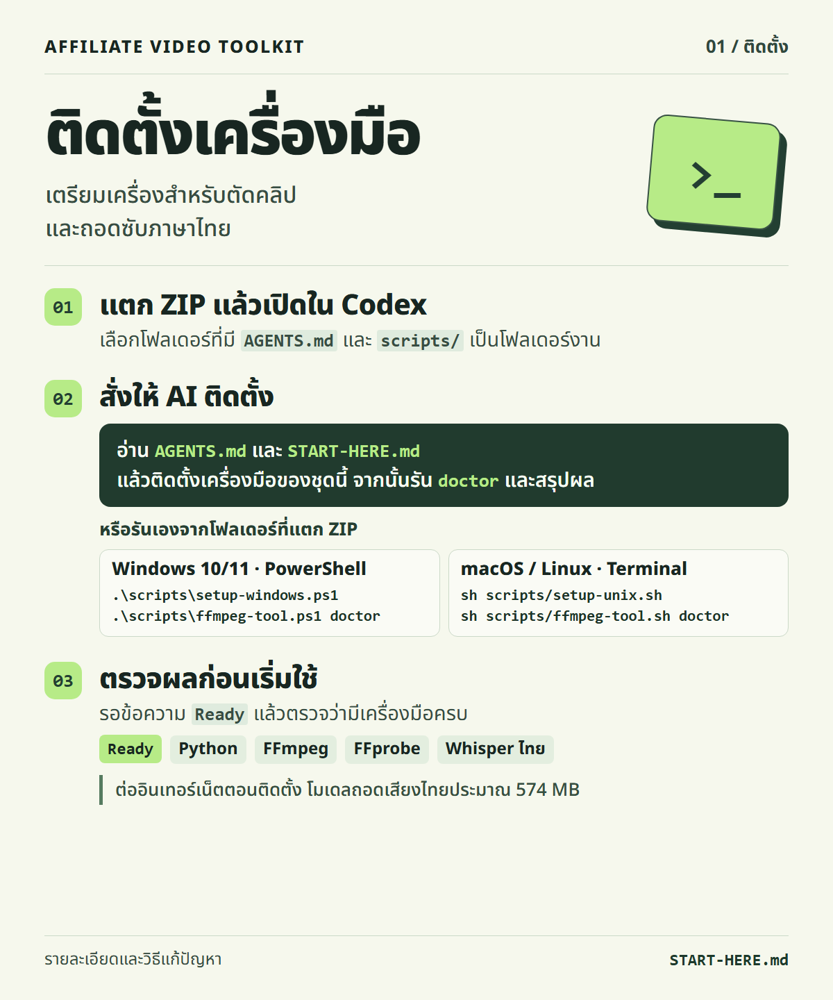
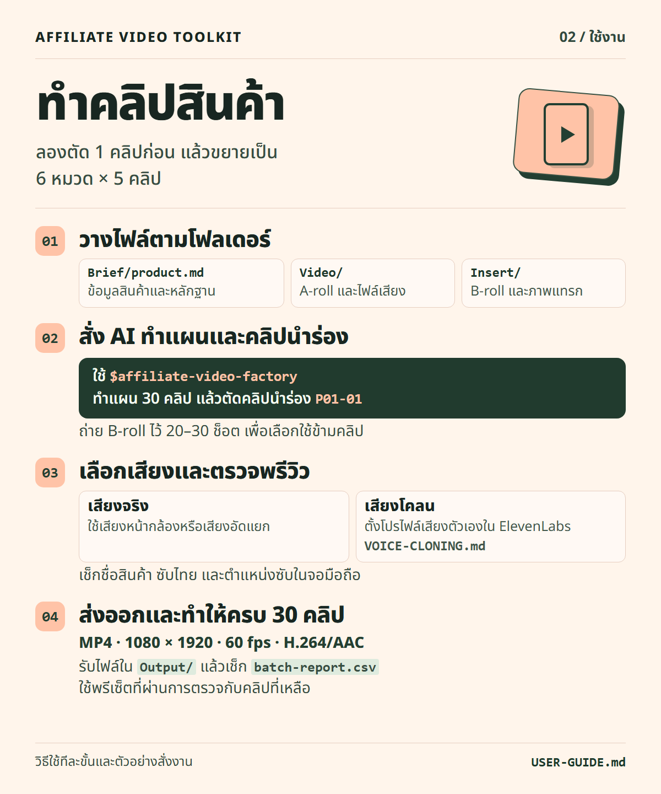
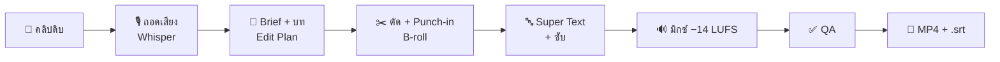

<div align="center">

# ✂️ PromptCut

**จากคลิปดิบ สู่คลิป TikTok ไวรัล — สั่งด้วยพรอมป์เดียว**

ชุดเครื่องมือให้ AI agent (Claude Code / Codex) ตัดคลิปแนวตั้งภาษาไทยให้คุณ<br>
ถอดเสียง · ตัดช่วงเงียบ · Super Text · B-roll · ซับ · มิกซ์เสียง · ตรวจไฟล์ก่อนส่ง


</div>

---

## ทำอะไรได้

| | |
| --- | --- |
| 🎙️ **ถอดเสียงไทยในเครื่อง** | Whisper large-v3-turbo ไม่ต้องอัปโหลดคลิป |
| ✂️ **ตัดให้กระชับ** | ตัดช่วงเงียบและเทคที่พูดผิด โดยจุดตัดอยู่ในช่วงเงียบจริง เสียงไม่ขาด |
| 🔤 **Super Text สไตล์ไวรัล** | ฟอนต์ไทยมินิมอล ตัวอักษรเด้ง สีตามแบรนด์ อยู่ใน Safe Zone ของ TikTok |
| 🎞️ **B-roll การ์ด + Punch-in** | ปิด jump cut ภาพตรงคำพูด ไม่บังหน้าคนพูด |
| 🔊 **มิกซ์เสียงพร้อมโพสต์** | −14 LUFS, true peak ≤ −1 dB, เพลงเบา ๆ แบบ duck, SFX แบบมินิมอล |
| 🗣️ **เสียงโคลน (ไม่บังคับ)** | ElevenLabs `eleven_v4` รองรับภาษาไทย |
| ✅ **ตรวจก่อนส่ง** | ffprobe, loudness, ถอดเสียงซ้ำ, contact sheet — ไม่ผ่านไม่ส่ง |

## เริ่มใน 3 ขั้น

```text
1. โคลน repo แล้วเปิดโฟลเดอร์ใน Claude Code หรือ Codex
2. พิมพ์:  อ่าน AGENTS.md และ START-HERE.md แล้วติดตั้งเครื่องมือให้
3. วางคลิปใน Raw File/ แล้วพิมพ์:  ตัดคลิปนี้เป็น TikTok แนวตั้ง ตามสไตล์ใน Example/
```

ติดตั้งเองก็ได้:

```powershell
.\scripts\setup-windows.ps1
.\scripts\ffmpeg-tool.ps1 doctor
```

```bash
sh scripts/setup-unix.sh && sh scripts/ffmpeg-tool.sh doctor
```

<p align="center">
  
  
</p>

## เบื้องหลัง



## โครงสร้าง

```text
AGENTS.md            ← จุดเริ่มของ AI agent
.agents/skills/      ← สกิลแต่ละขั้น (บท, ถ่าย, เสียง, ตัด, QA, รสนิยมการตัด)
scripts/             ← ตัวติดตั้ง + ตัวเรียก ffmpeg-skill
assets/fonts/        ← ฟอนต์ไทย OFL
PROMPTS.md           ← พรอมป์พร้อมคัดลอก
WORKFLOW.md          ← คู่มือเต็ม: โฟลเดอร์, สถานะงาน, คำสั่ง
.work/…/render_v4.py ← ตัวอย่าง renderer ที่ใช้งานจริง
```

วางไฟล์ของคุณใน `Raw File/` · `Example/` · `B-roll/` · `Guide Voice/` แล้วรับงานที่ `Output/` — โฟลเดอร์เหล่านี้ไม่ถูก commit

## อ่านต่อ

[ติดตั้ง](START-HERE.md) · [ใช้งานทีละขั้น](USER-GUIDE.md) · [พรอมป์](PROMPTS.md) · [คู่มือเต็ม](WORKFLOW.md) · [เสียงโคลน](VOICE-CLONING.md) · [ตัดด้วย Remotion](prompts%20remotion.md)

## เครดิตและสิทธิ์

- [ffmpeg-skill](.agents/skills/ffmpeg-skill/) โดย kajisho5 (MIT)
- ฟอนต์ Kanit, Noto Sans Thai, Anuphan, IBM Plex Sans Thai (SIL OFL 1.1) · แนะนำ [LINE Seed Sans TH](https://seed.line.me/) สำหรับ Super Text (ดาวน์โหลดเองลง `assets/fonts/lineseed/`)
- เพลง/SFX/B-roll ใช้ไฟล์ที่คุณมีสิทธิ์ เช่น [Mixkit](https://mixkit.co/) และ [Pexels](https://www.pexels.com/)
- โพสต์คลิปที่ใช้เสียงหรือภาพ AI บน TikTok ต้องติดป้ายเนื้อหา AI

<div align="center"><sub>Made in Thailand 🇹🇭 · ตัดเร็ว ส่งไว ไม่ต้องนั่งไล่ timeline</sub></div>
